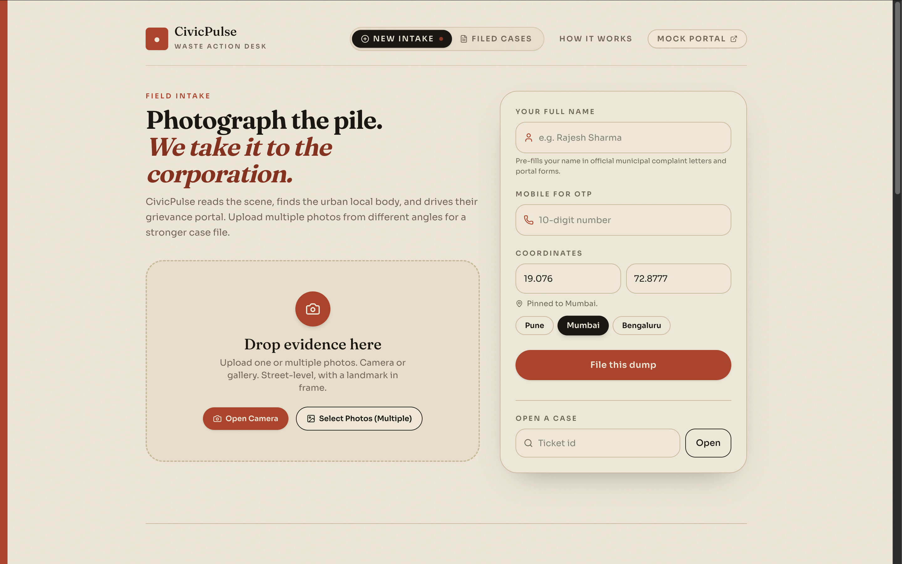
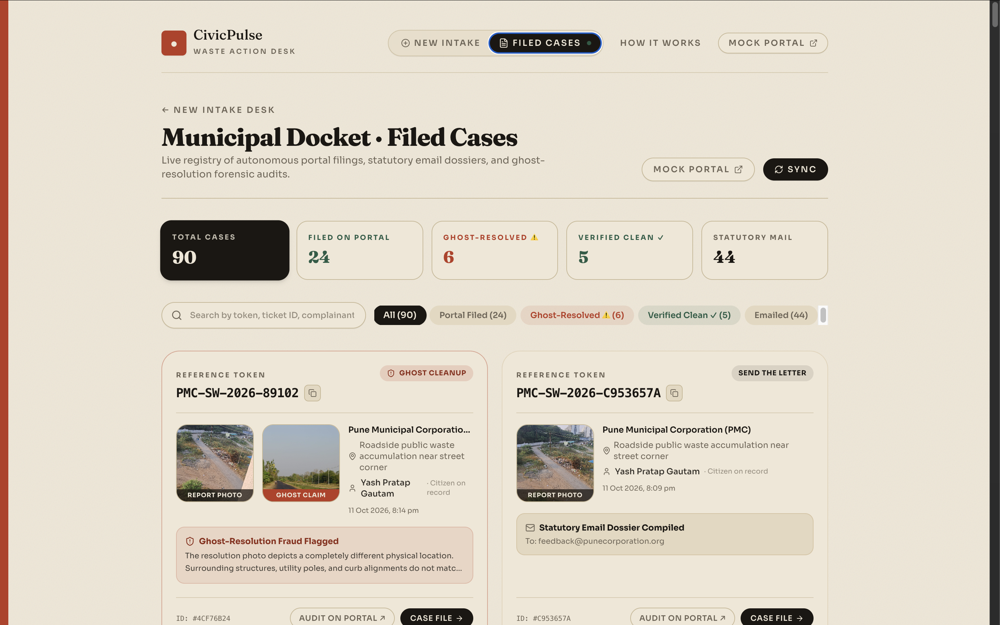

# CivicPulse AI ⚡🏛️

> **Autonomous Civic Waste Action & Ghost-Resolution Auditor Engine**  
> *Transforming citizen reports into verified municipal action with multimodal AI, automated browser filing, and forensic cleanup fraud detection.*

[](LICENSE)
[](https://www.python.org/)
[](https://fastapi.tiangolo.com/)
[](https://react.dev/)
[](https://www.typescriptlang.org/)
[](https://tailwindcss.com/)
[](https://playwright.dev/)
[](https://aws.amazon.com/dynamodb/)
[](https://aws.amazon.com/s3/)
[](https://groq.com/)

---

## 📌 Table of Contents

- [Overview](#-overview)
- [Interface & Screenshots](#-interface--screenshots)
- [The Problem We Solve](#-the-problem-we-solve)
- [Key Features](#-key-features)
- [System Architecture](#-system-architecture)
- [Tech Stack](#-tech-stack)
- [Repository Structure](#-repository-structure)
- [Quickstart & Local Setup](#-quickstart--local-setup)
  - [Prerequisites](#prerequisites)
  - [1. Backend Setup](#1-backend-setup)
  - [2. Frontend Setup](#2-frontend-setup)
  - [3. Running with Docker Compose](#3-running-with-docker-compose)
- [Configuration & Environment Variables](#-configuration--environment-variables)
- [API Reference](#-api-reference)
- [Testing & Quality Assurance](#-testing--quality-assurance)
- [AWS Cloud Deployment](#-aws-cloud-deployment)
- [Contributing & License](#-contributing--license)

---

## 🌟 Overview

**CivicPulse AI** bridges the gap between citizens, municipal authorities (Urban Local Bodies), and accountability. 

Instead of forcing citizens through confusing government portals with dozens of dropdowns and phone verifications, CivicPulse AI allows a citizen to simply **snap a photo** of roadside garbage or an illegal dump. The platform handles everything downstream:

1. **Classifies and triages** the waste via multimodal vision models.
2. **Identifies the administrative Urban Local Body (ULB)** using fast geo-routing and dynamic web discovery.
3. **Files the grievance autonomously** using an intelligent browser automation agent that navigates municipal portals (e.g., PMC, PCMC, BMC) and coordinates citizen OTP verification.
4. **Detects "Ghost Resolutions"**: When municipal contractors mark the ticket as resolved, CivicPulse runs a forensic multimodal image comparison to catch false closures (mismatched scenes, angled photography, uncleared debris) and automatically reopens the complaint.

---

## 📸 Interface & Screenshots

### 1. Field Intake Desk
*Streamlined citizen evidence intake with photo dropzone, multi-angle upload, sub-millisecond metro coordinate pinning (Pune, Mumbai, Bengaluru), and direct automated filing dispatch.*

<p align="center">
  
</p>

### 2. Municipal Docket & Ghost-Resolution Audit Registry
*Live telemetry dashboard featuring real-time filing statuses, statutory email dossiers, KPI metrics, and side-by-side forensic visual audits alerting citizens to ghost-resolution contractor fraud.*

<p align="center">
  
</p>

---

## 🚨 The Problem We Solve

```
   CITIZEN REPORTING                        MUNICIPAL REDRESSAL
┌──────────────────────┐                 ┌──────────────────────┐
│  Tedious portals &   │ ──(Friction)──▶ │ Abandoned complaints │
│   unclear dropdowns  │                 │    or lost tokens    │
└──────────────────────┘                 └──────────────────────┘
                                                    │
                                                    ▼
┌──────────────────────┐                 ┌──────────────────────┐
│  "Ghost Resolution"  │ ◀─(No Audit)─── │ Contractor submits   │
│  Garbage remains,    │                 │ fake "clean" photo   │
│  ticket marked closed│                 │ from another street  │
└──────────────────────┘                 └──────────────────────┘
```

1. **High Citizen Friction**: Filing a municipal grievance in India often requires navigating legacy government portals, finding ward-specific categories, and enduring complex form fields.
2. **Ghost Resolutions**: Municipal workers and private contractors frequently mark grievances "Resolved" by uploading irrelevant photos (e.g., taking a picture of a clean pavement 50 meters away or framing the camera away from the garbage pile).
3. **Lack of Automated Fallback**: If a municipal portal is down or times out, citizen reports simply fail with no escalation trail.

---

## ✨ Key Features

- **⚡ Multimodal Vision Triage**:
  - Powered by Groq's high-speed vision models (`qwen/qwen3.8-27b`).
  - Instantly filters out non-garbage images (pets, clean roads, selfies, vehicles).
  - Categorizes waste types (`plastic`, `organic`, `construction_debris`), scores severity (1–5), extracts landmark context, and drafts a statutory complaint citing public health hazards.

- **🧭 Sub-Millisecond Authority Geo-Routing**:
  - Fast bounding-box lookups for metropolitan corporations (Pune PMC, Pimpri-Chinchwad PCMC, Mumbai BMC, Bengaluru BBMP).
  - Reverse geocoding via OpenStreetMap Nominatim for locations outside pre-indexed bounding boxes.
  - **Autonomous Web Discovery Agent**: Uses DuckDuckGo search + Groq reasoning to dynamically find grievance portals and official nodal emails for any unindexed municipality in India.

- **🤖 Autonomous Browser Filing Agent (Playwright)**:
  - Automates Chromium navigation across municipal complaint portals.
  - Handles category selection, landmark entry, description injection, and photo uploads.
  - **Human-in-the-Loop OTP Relay**: Listens for portal OTP challenges, prompts the citizen via a real-time modal, and completes two-factor authorization seamlessly.
  - Scrapes and records official municipal confirmation tokens (e.g. `PMC-SW-2026-89102`).

- **🔍 Forensic Ghost-Resolution Auditor**:
  - Compares the citizen's original "Before" photo with the contractor's "After" resolution submission.
  - Performs structural landmark verification (`is_same_scene`), debris clearance checking (`debris_cleared`), and fraud detection (`fraud_detected`).
  - Automatically transitions status to `CONFIRMED_CLEAN` or `REOPENED_AUDIT_FAILED`, compiling an escalation dossier if fraud is detected.

- **📨 Statutory Email Fallback & Web Share**:
  - If a government portal is offline or encounters non-recoverable errors, CivicPulse compiles a formal legal notice addressed to the Municipal Commissioner with presigned evidence links.
  - One-tap dispatch via native `mailto:` or the Web Share API.

- **🔒 Privacy by Design**:
  - Automatic PII masking across all public APIs and dashboards (`••••••1234`).

---

## 🏗️ System Architecture

```
                                 ┌───────────────────────────────────┐
                                 │       Citizen Mobile PWA          │
                                 │   (React 19 + TypeScript + Vite)  │
                                 └─────────────────┬─────────────────┘
                                                   │
                                     REST API / Multipart Upload
                                                   │
                                                   ▼
                                 ┌───────────────────────────────────┐
                                 │         FastAPI Backend           │
                                 │   (Intake Router & Worker Host)   │
                                 └─────┬───────────┬───────────┬─────┘
                                       │           │           │
                 ┌─────────────────────┘           │           └─────────────────────┐
                 ▼                                 ▼                                 ▼
   ┌───────────────────────────┐     ┌───────────────────────────┐     ┌───────────────────────────┐
   │     Groq Inference        │     │     OpenStreetMap /       │     │     AWS Cloud Services    │
   │ • Triage (Vision)         │     │     Discovery Agent       │     │ • DynamoDB (Single-Table) │
   │ • Forensic Audit (Vision) │     │ • Reverse Geocoding       │     │ • S3 (Evidence Store)     │
   │ • Statutory Drafting (LLM)│     │ • DDGS Web Portal Search  │     │ • CloudFront & IAM Roles  │
   └───────────────────────────┘     └───────────────────────────┘     └───────────────────────────┘
                 │                                 │                                 │
                 └─────────────────────┬───────────┴─────────────────────────────────┘
                                       ▼
                         ┌───────────────────────────┐
                         │   Autonomous Playwright   │
                         │       Browser Worker      │
                         └─────────────┬─────────────┘
                                       │
                         ┌─────────────┴─────────────┐
                         ▼                           ▼
            ┌──────────────────────────┐┌──────────────────────────┐
            │   Live Municipal ULB     ││    Built-in Mock Portal  │
            │   (complaint.pmc.gov.in) ││   (/mock-pmc-portal)     │
            └──────────────────────────┘└──────────────────────────┘
```

---

## 🛠️ Tech Stack

| Domain | Technologies |
|---|---|
| **Frontend** | React 19, TypeScript, Vite, Tailwind CSS v4, Lucide Icons, Oxlint |
| **Backend** | Python 3.11+, FastAPI, Uvicorn, Pydantic v2, Pillow, Pillow-HEIF |
| **Browser Automation** | Playwright (Chromium headless/headed runner) |
| **AI / Computer Vision** | Groq Cloud (`qwen/qwen3.8-27b`, `openai/gpt-oss-120b`) |
| **Cloud & Storage** | AWS DynamoDB (Single-table design), AWS S3 (Presigned evidence store) |
| **Geocoding & Search** | OpenStreetMap Nominatim, DuckDuckGo Search (`ddgs`) |
| **DevOps & Containers** | Docker, Docker Compose, AWS EC2 / App Runner / ECS |

---

## 📁 Repository Structure

```
civicpulse-ai/
├── backend/
│   ├── Dockerfile                   # Production container with Playwright & Python 3.11
│   ├── requirements.txt             # Backend dependencies
│   ├── .env.example                 # Environment configuration template
│   ├── app/
│   │   ├── main.py                  # FastAPI application entrypoint & middleware
│   │   ├── config.py                # Pydantic Settings & environment loader
│   │   ├── api/
│   │   │   ├── routes.py            # Primary endpoints (/reports, /tickets, /otp, /audit)
│   │   │   └── mock_portal.py       # Full-fidelity mock municipal grievance portal
│   │   ├── core/
│   │   │   ├── dynamodb.py          # DynamoDB CRUD, single-table schemas & caching
│   │   │   └── s3.py                # S3 bucket uploads & presigned URL generators
│   │   └── services/
│   │       ├── triage_service.py    # Multimodal image triage & waste validation
│   │       ├── audit_service.py     # Forensic before/after cleanup verification
│   │       ├── geo_router.py        # Metro bounding-box resolver & OSM reverse geocoding
│   │       ├── discovery_agent.py   # Web discovery of ULB portals & official emails
│   │       └── filing_agent.py      # Autonomous Playwright portal worker & OTP state loop
│   └── tests/                       # E2E test scripts & sample evaluation photos
│       ├── dump.jpeg                # Test fixture: initial street waste
│       ├── cleaned.jpg              # Test fixture: genuine verified cleanup
│       └── fake_clean.jpg           # Test fixture: mismatched/fraudulent cleanup
├── frontend/
│   ├── package.json                 # Frontend dependencies & scripts
│   ├── vite.config.ts               # Vite bundler & Tailwind configuration
│   └── src/
│       ├── App.tsx                  # Root navigation & layout shell
│       ├── api.ts                   # Typed API client with auto-fallback
│       ├── types.ts                 # TypeScript domain interfaces
│       ├── status.ts                # Ticket status formatting & badge metadata
│       └── components/
│           ├── Capture.tsx          # Camera intake, GPS capture & waste validation
│           ├── CaseFile.tsx         # Live telemetry, steps tracker, & evidence views
│           ├── CasesList.tsx        # Filterable case registry with KPIs
│           ├── AuditBay.tsx         # Forensic diff inspection modal
│           ├── OtpSheet.tsx         # Real-time citizen OTP entry modal
│           └── HowItWorks.tsx       # System overview & transparency guide
├── docs/
│   └── PLAN.md                      # Sprint master schedule & architectural roadmap
├── images/                          # UI & application demonstration screenshots
│   ├── NewIntakePage.png            # Intake desk: Multi-photo capture & GPS routing
│   └── FiledCasesPage.png           # Municipal docket: Case telemetry & forensic audits
├── docker-compose.yml               # Unified local/cloud Docker orchestration
└── README.md                        # Project documentation (this file)
```

---

## 🚀 Quickstart & Local Setup

### Prerequisites

- **Node.js**: v18+ (v20+ recommended)
- **Python**: 3.11+
- **Groq API Key**: Obtain a free/tier key from [console.groq.com](https://console.groq.com/keys)
- **AWS Credentials** *(Optional for local mock mode)*: DynamoDB & S3 access or local mock fallbacks.

---

### 1. Backend Setup

1. **Navigate to the backend directory and set up a virtual environment:**
   ```bash
   cd backend
   python3 -m venv venv
   source venv/bin/activate    # On Windows: venv\Scripts\activate
   ```

2. **Install dependencies:**
   ```bash
   pip install -r requirements.txt
   ```

3. **Install Playwright browser binaries:**
   ```bash
   playwright install chromium
   ```

4. **Configure environment variables:**
   ```bash
   cp .env.example .env
   ```
   Open `.env` and fill in your `GROQ_API_KEY`:
   ```env
   GROQ_API_KEY=gsk_your_groq_api_key_here
   PORTAL_MODE=mock
   HEADLESS_BROWSER=true
   ```

5. **Start the FastAPI development server:**
   ```bash
   uvicorn app.main:app --host 0.0.0.0 --port 8000 --reload
   ```

   The backend will be available at `http://localhost:8000`.  
   Interactive API docs are available at `http://localhost:8000/docs`.  
   The mock municipal portal is available at `http://localhost:8000/mock-pmc-portal`.

---

### 2. Frontend Setup

1. **Open a new terminal and navigate to the frontend directory:**
   ```bash
   cd frontend
   ```

2. **Install frontend dependencies:**
   ```bash
   npm install
   ```

3. **Configure environment variables (optional):**
   ```bash
   cp .env.example .env
   ```
   By default, Vite proxies `/api` calls directly to `http://localhost:8000`. If running on a different port or host, specify:
   ```env
   VITE_API_BASE_URL=http://localhost:8000
   ```

4. **Start the Vite development server:**
   ```bash
   npm run dev
   ```

   Open your browser at `http://localhost:5173`.

---

### 3. Running with Docker Compose

To run the entire backend containerized with Playwright, Chromium dependencies, and FastAPI:

```bash
# From the project root
docker compose up -d --build
```

Check health:
```bash
curl http://localhost:8000/health
```

---

## ⚙️ Configuration & Environment Variables

### Backend (`backend/.env`)

| Variable | Default | Description |
|---|---|---|
| `GROQ_API_KEY` | *(Required)* | Groq Cloud API key for ultra-fast vision & text inference |
| `GROQ_VISION_MODEL` | `qwen/qwen3.8-27b` | Model used for multimodal triage & before/after audit |
| `GROQ_TEXT_MODEL` | `openai/gpt-oss-120b` | Model used for statutory drafting & web extraction |
| `PORTAL_MODE` | `mock` | `mock` (uses built-in `/mock-pmc-portal`) or `live` (navigates real portals) |
| `HEADLESS_BROWSER` | `true` | Runs Chromium headless. Set `false` for live visual debugging |
| `AWS_REGION` | `us-east-1` | Target AWS region for DynamoDB and S3 |
| `AWS_ACCESS_KEY_ID` | `""` | AWS Key (leave blank when using EC2/ECS IAM Roles) |
| `AWS_SECRET_ACCESS_KEY` | `""` | AWS Secret (leave blank when using EC2/ECS IAM Roles) |
| `DYNAMODB_TABLE` | `CivicPulseTable` | DynamoDB table name for tickets and authority cache |
| `S3_BUCKET` | `civicpulse-evidence-store` | S3 bucket for storing citizen evidence photos |
| `CORS_ORIGINS` | `*` | Comma-separated list of allowed CORS origins |
| `PORT` | `8000` | Port for the FastAPI server |

### Frontend (`frontend/.env`)

| Variable | Default | Description |
|---|---|---|
| `VITE_API_BASE_URL` | `""` *(same-origin)* | Absolute URL of the backend API (e.g. `http://localhost:8000`) |

---

## 📡 API Reference

### Core Endpoints

#### `POST /api/v1/triage`
Performs standalone multimodal vision triage on an uploaded image without creating a ticket.
- **Request**: Multipart `image` or `images`
- **Response**:
  ```json
  {
    "is_valid_waste": true,
    "rejection_reason": null,
    "waste_categories": ["plastic", "organic_food"],
    "severity": 4,
    "landmark_context": "Roadside junction next to electrical transformer",
    "complaint_text": "Severe accumulation of unsegregated solid waste obstructing public pathway..."
  }
  ```

#### `POST /api/v1/reports`
Intake endpoint that processes evidence images, extracts GPS coordinates, performs triage, resolves the governing authority, writes ticket state to DynamoDB, and dispatches the background Playwright filing worker.
- **Request Form-Data**:
  - `image` / `images`: Evidence image file(s)
  - `lat`: Citizen latitude (float)
  - `lng`: Citizen longitude (float)
  - `user_phone`: Citizen contact number (string)
  - `user_name`: Citizen name (optional)
- **Response**: Returns created ticket metadata, S3 evidence URLs, and initial `QUEUED_FOR_FILING` status.

#### `GET /api/v1/tickets`
Lists all filed and emailed tickets. Citizen mobile numbers are automatically masked for privacy.
- **Query Params**: `status` (optional filter), `limit` (default: 100)

#### `GET /api/v1/tickets/{ticket_id}`
Retrieves real-time ticket status, filing telemetry, discovered authority, and audit results.

#### `POST /api/v1/tickets/{ticket_id}/submit-otp`
Relays the citizen's OTP to the active background Playwright worker.
- **Request Body**: `{ "otp": "592014" }`

#### `POST /api/v1/tickets/{ticket_id}/simulate-resolution`
Simulates municipal resolution by submitting an "After" photo. Runs the forensic audit comparison against the original "Before" photo.
- **Request Form-Data**: `after_image` (UploadFile)
- **Response**: Updated ticket with audit scores (`is_same_scene`, `debris_cleared`, `fraud_detected`, `confidence`, `discrepancy_notes`).

#### `GET /mock-pmc-portal`
Serves the built-in municipal grievance portal simulator, allowing reliable demonstration of autonomous filing, OTP generation, and token retrieval without dependency on live external sites.

#### `GET /health`
Health check endpoint for AWS Application Load Balancers, ECS, and container probes.

---

## 🧪 Testing & Quality Assurance

Run the automated test suite from the backend directory:

```bash
cd backend
source venv/bin/activate

# 1. Test Multimodal Triage and Ghost-Audit logic:
python tests/tests_triage_audit.py

# 2. Test ULB Authority Web Discovery:
python tests/tests_discovery.py

# 3. Test Full End-to-End Pipeline (Intake -> Mock Filing -> Audit):
python tests/test_e2e_pipeline.py

# 4. (Optional) Test live municipal portal navigation:
python tests/test_live_municipal_navigation.py
```

### Pre-packaged Demo Fixtures:
- **`backend/tests/dump.jpeg`**: Realistic street garbage accumulation (triages as valid severity 4 waste).
- **`backend/tests/cleaned.jpg`**: Matching street scene with debris removed (passes audit as `CONFIRMED_CLEAN`).
- **`backend/tests/fake_clean.jpg`**: Unrelated clean street scene (flagged by forensic auditor as `REOPENED_AUDIT_FAILED`).

---

## ☁️ AWS Cloud Deployment

CivicPulse AI is architected for production deployment on AWS:

```
                      ┌────────────────────────┐
                      │   Amazon CloudFront    │
                      └───────────┬────────────┘
                                  │
             ┌────────────────────┴────────────────────┐
             ▼                                         ▼
  ┌──────────────────────┐                  ┌──────────────────────┐
  │    Amazon S3 Bucket  │                  │   AWS EC2 / ECS      │
  │  (Static React Dist) │                  │ (FastAPI + Chromium) │
  └──────────────────────┘                  └──────────┬───────────┘
                                                       │
                                  ┌────────────────────┴────────────┐
                                  ▼                                 ▼
                        ┌───────────────────┐             ┌───────────────────┐
                        │  Amazon DynamoDB  │             │     Amazon S3     │
                        │ (State & Caching) │             │  (Evidence Store) │
                        └───────────────────┘             └───────────────────┘
```

1. **Frontend Hosting**: Build the static bundle (`npm run build`) and sync to an Amazon S3 bucket configured with Amazon CloudFront.
2. **Backend Hosting**: Deploy the container on an **AWS EC2 instance (`t3.medium`)** or **AWS ECS Fargate** with Docker.
3. **IAM Authentication**: The backend automatically leverages IAM Instance Profiles / ECS Task Roles for zero-credential Boto3 access to DynamoDB (`CivicPulseTable`) and S3 (`civicpulse-evidence-store`).

---

## 🤝 Contributing

Contributions, feedback, and pull requests are welcome!

1. Fork the Project
2. Create your Feature Branch (`git checkout -b feature/AmazingFeature`)
3. Commit your Changes (`git commit -m 'Add some AmazingFeature'`)
4. Push to the Branch (`git push origin feature/AmazingFeature`)
5. Open a Pull Request

---

## 📄 License

Distributed under the MIT License. See `LICENSE` for more information.

---

<p align="center">
  Built with ❤️ for cleaner cities and transparent civic governance.
</p>
